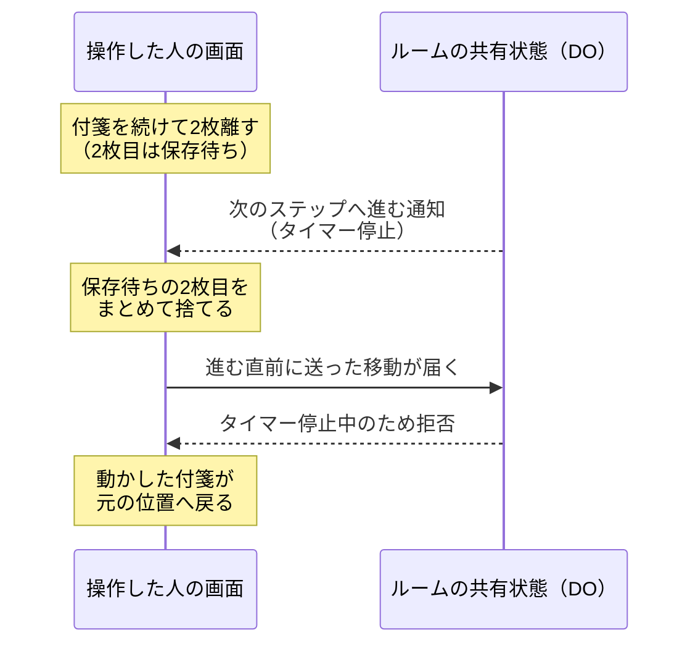
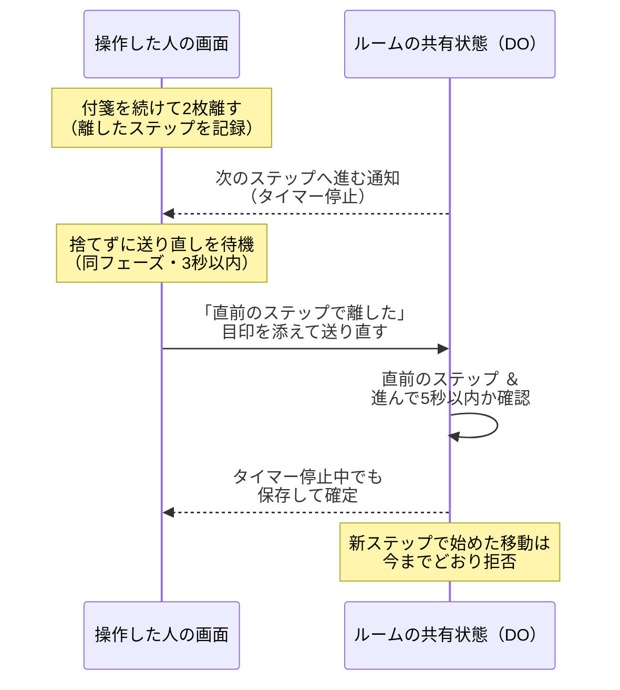
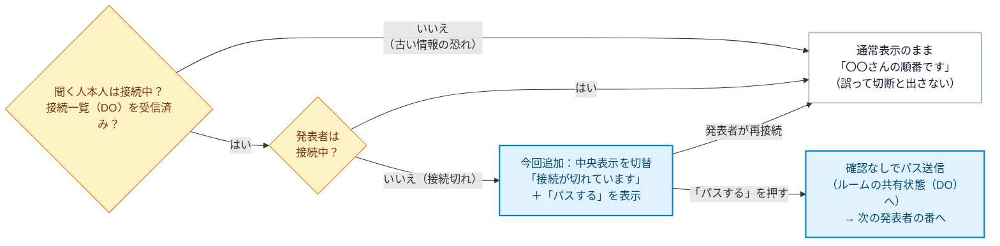
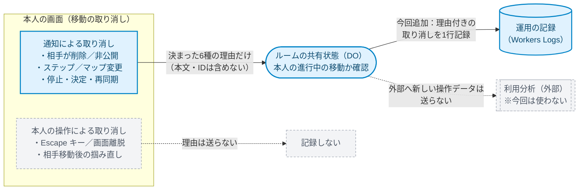
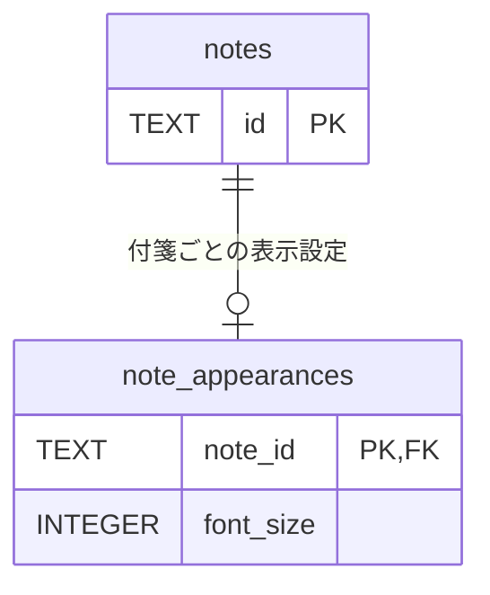

# 仕組みの図のカタログ・見本・DB変更

要否・3つの型・見やすさのガードは [仕組みの図の書き方](../../../../docs/loop/writing.md#仕組みの図の書き方)、現在の責務は [構成概要](../../../../docs/architecture/overview.md) を参照する。図は下のカタログから選んで一発で出し、Playwright 等での描画検査・撮影はしない。

## 部品と言葉のカタログ

### 箱の種類と Mermaid の書き方

`flowchart` は次の部品と `classDef` だけを組み合わせる。`sequenceDiagram` は `classDef` を使わず、`participant` に下の役割（仕組み）名だけを使い、`Note` で補足する。

| 箱の種類                   | 形（`flowchart`）              | `classDef` | 使いどころ                                                          |
| -------------------------- | ------------------------------ | ---------- | ------------------------------------------------------------------- |
| 画面・表示                 | `id["..."]`（枠は `subgraph`） | `screen`   | 人の画面、表示・操作の状態                                          |
| 共有状態・入口             | `id(["..."])`                  | `state`    | ルームの共有状態（DO）、参加状況の管理（DO）、API の入口（Workers） |
| 保存先・記録               | `id[("...")]`                  | `store`    | D1、KV、Workers Logs                                                |
| 外部サービス               | `id[["..."]]`                  | `external` | 利用分析（外部）など学外へ出る境界                                  |
| 判断の分かれ道             | `id{"..."}`                    | `decision` | 条件分岐・誤検知防止・認可の確認                                    |
| 今回追加・変更（上書き）   | 元の形のまま                   | `changed`  | 今回の PR で足した／変えた箱                                        |
| 送らない・対象外（上書き） | 元の形のまま＋点線矢印 `-.->`  | `muted`    | 記録しない・外部へ送らない経路                                      |

使ったクラスだけ図の末尾へ貼る（ライト／ダーク両方で読めるよう `fill`・`stroke`・`color` を組で書く）。

```text
classDef screen fill:#fff,stroke:#64748b,color:#0f172a
classDef state fill:#ede9fe,stroke:#7c3aed,color:#4c1d95
classDef store fill:#ecfdf5,stroke:#059669,color:#065f46
classDef external fill:#f1f5f9,stroke:#475569,color:#1e293b
classDef decision fill:#fef3c7,stroke:#d97706,color:#78350f
classDef changed fill:#e0f2fe,stroke:#0284c7,stroke-width:2px,color:#0c4a6e
classDef muted fill:#f3f4f6,stroke:#9ca3af,stroke-dasharray:4 3,color:#4b5563
```

### 役割（仕組み）名の一覧

関数名・ファイル名・イベント名・型名・コンポーネント名は図に入れない。画面の文言や進行の呼び方は [用語集](../../../../docs/glossary.md) に合わせる。

| 図に書かない（コード上の名前）                           | 図で使う呼び方（役割（仕組み））                                                                                         | 使いどころ                                       |
| -------------------------------------------------------- | ------------------------------------------------------------------------------------------------------------------------ | ------------------------------------------------ |
| `Browser`・`use-note-move`・`RoomBoardCanvas` など       | **本人の画面**／**操作した人の画面**／**発表者の画面**／**聞く人の画面**／**ほかの参加者の画面**                         | 誰が操作し、誰の画面が変わるかを示す             |
| `RoomDO`・`workers/room/*`                               | **ルームの共有状態（DO）**                                                                                               | 1 ルームの進行・付箋・接続・認可の真実を持つ場所 |
| `AccountDO`                                              | **参加状況の管理（DO）**                                                                                                 | 同時参加制限や別ルームへの切り替えが論点のとき   |
| `D1`                                                     | **完了したルームの保存先（D1）**／**一覧・履歴の保存先（D1）**                                                           | その PR での役割を前に書く                       |
| `Workers Logs`                                           | **運用の記録（Workers Logs）**                                                                                           | 本番ログへの出力が論点のとき                     |
| `KV`                                                     | **キャッシュ・一時保存（KV）**                                                                                           | KV を読み書きする変更のとき                      |
| `api-worker`・`app-worker`・`contracts/`                 | 原則省く（境界自体が変更点のときだけ **API の入口（Workers）**／**画面サーバー（Workers）**）                            | 中継層が変わらなければ描かない                   |
| `PostHog` など外部サービス                               | **利用分析（外部）**／**外部サービス名（外部）**                                                                         | データが学外へ出るかどうかを区別する             |
| `note:move:start`・`visibility: "private"`・`ready` など | **日本語の動作**と[用語集](../../../../docs/glossary.md)の語（例：「付箋の移動を送る」「マイ付箋」「まって！」「除外」） | 実装語を図へ持ち込まない                         |

## 1. やり取りの図（時間順）：ステップが進む直前に離した付箋を保存する（#1450・R2）

画面の見た目は変わらないが、画面と DO のタイミングのすれ違いを直す PR。変更前と変更後の 2 図を縦に並べるため `<details>` で折りたたむ。

> ステップが進む直前に離した付箋の移動を捨てず、「直前のステップで離した」目印を添えて送り直し、ルームの共有状態（DO）は次のステップに入ってから 5 秒以内ならタイマー停止中でも保存します。

<details>
<summary>仕組みの図：ステップ進行と付箋移動のすれ違い（変更前／変更後）</summary>

#### 変更前



#### 変更後



</details>

## 2. 状態・条件の図：発表者の接続が切れたら聞く人がその場でパスできる（#1449・R1）

画面の見た目も変わるが、静止画スクショだけでは「誤って切断と出さない条件」「再接続で戻る動き」「確認なしでパスを送る動き」が写らない PR。短い 1 図なので開いたまま置く。

> 共有ステップで発表者の接続が切れている間だけ、聞く人の中央表示を「接続切れ＋パスする」へ切り替え、押すと確認なしでルームの共有状態（DO）へパスを送って次の発表者へ進みます（自分が切断中や接続一覧の未受信時は誤表示しません）。



## 3. データの流れの図：通知で付箋の移動を取り消した理由を本番で数える（#1429・R2）

画面の見た目も操作結果も変わらないが、「何を送って、何を送らず、どこへ残すか」というデータ境界が変わる PR。短い 1 図なので開いたまま置く。

> 通知が原因で画面が付箋の移動を取り消したときだけ、決まった 6 種類の理由をルームの共有状態（DO）経由で運用の記録（Workers Logs）へ残します（本人の操作・付箋の本文や ID は送らず、外部の利用分析にも出しません）。



## 図を省く PR と任意の PR の例

- **不要（描かない・R0）**：文言の出し分け（#1462）、カードの重なり調整（#1455）、読み上げ名の追加（#1464）、文書やテストのみの更新。
- **任意（単一画面の R1）**：決選投票のグループ枠の分け方（#1451）のように、基本は前後スクショで伝わるが「枠は分かれても裏の所属や名前編集は共通」など補足したい制約があるときだけ短い図を添える。

## DB変更：3種類の図に加えて書く

DB の構造・データの変更がある PR では、上のどの図を選んでも「DBの変更」を追加する。図が不要な DB 変更でも、スキーマの差分とデータへの影響は文章や表で示す。

- 対象：D1 / DO、対象のテーブル・カラム・制約・索引。
- 差分：変更前と変更後、既存行の扱い、初期値・補完・データ変換。
- 移行：該当する migration へのリンク、適用順、破壊的変更の有無と復旧時の注意点。
- 資料：関係が変わるなら ER 図、カラム・制約・索引だけなら差分表。生成済みの `Schema/SchemaDiagram`・`Schema/SchemaDetails` があれば利用し、関係する資料へ案内する。

適用後の読み書きや既存データの保持は、動作確認手順（または確認結果）の要件として確認条件・手順・結果を記載する。DB 検査や migration の扱いは [開発規約のMigration](../../../../docs/development/conventions.md#migration) に従う。D1 と DO は別の DB なので、両者を外部キーで結んだ ER 図を作らない。

### 例：ルームの共有状態（DO）に付箋ごとの文字サイズを保存する

[既存migration](../../../../workers/room-do-migrations/20260922114121-add-note-font-size.sql)を題材にした記述例。新しいテーブルを足す場合は関係図、既存データへの影響は短い表にする。



| 観点         | 変更前                  | 変更後                                                     |
| ------------ | ----------------------- | ---------------------------------------------------------- |
| 保存先       | `note_appearances` なし | ルームの共有状態（DO）に `note_appearances` を追加         |
| 付箋との関係 | なし                    | `note_id` を主キー・外部キーとし、付箋削除時は設定も削除   |
| 文字サイズ   | 個別設定の保存なし      | `font_size` は整数 12〜24、NOT NULL、DEFAULT 14            |
| 既存データ   | 既存の付箋              | 付箋行を保持。設定行がない付箋はアプリ側で 14px として補完 |

設定行の追加は migration で既存付箋ごとに行うのではなく、行がない場合の読み取りで補完する。これは SQL の DEFAULT だけでは説明できないため、既存データの扱いに明記する。復旧でこの表を削除すると保存済みの個別設定を失う。マージ済みの RoomDO migration を編集して戻さず、必要な変更は新しい migration で行う。
